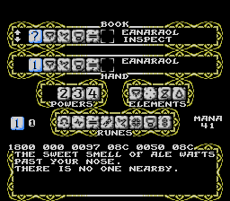
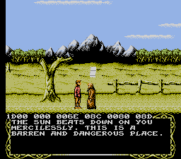
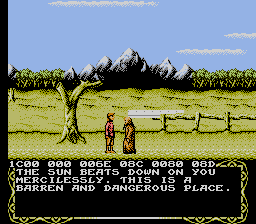

# 18 — shared drawing layer scaffold

## Iteration 1 — 2026-10-26

- Added `src/magician/DRAW.PDS`: first concrete piece of the shared drawing
  layer, a horizontal fill primitive (`drawfill`: A = tile, X = count) that
  writes to `$2007`, placed in the fixed `$E000` window at `$FAFF` (slot 15).
- Manifest entry added to `asm/build.py:OUR_MODULES` (`DRAW.PDS`, slot 15,
  origin `$FAFF`).
- Test added: `src/testing/test_draw_layer.py` (10 checks) verifying manifest
  consistency, assembly, label resolution, and emitted bytes.
- vendor/ untouched; `make guard` clean; `make check-py` 24/24 pass; build
  exits 0.

## Iteration 2 — 2026-10-26: the honest placement check

The scaffold's claim to "place" DRAW.PDS at $FAFF was **wrong**. Measured:

- `make` rebuilt and `asm/build.py` reported DRAW.PDS "11 byte(s) written
  $1FAFF-$1FB09", while the finished `out/prg.bin` read `FF x11` at those
  offsets. The module was assembled and then **overwritten**: `our_modules()`
  sorted `DRAW.PDS` alphabetically in front of `SLOT15.PDS`, and the full-slot
  recreate wrote Beta 1's bytes back over it. `cmpbank.py bank` kept showing
  131072/131072 identical, because both sides carry Beta 1's own `$FF`
  end-of-code padding at $FAFF-$FB7F. A 100.00% match over a module that was
  not in the ROM.
- The "Beta 1 holds real non-zero bytes at $FAFF-$FB7F" fear, from the same
  authority, is also measured false. `cmpbank.py runs --kind missing` prints
  nothing for the fixed window: the ONLY >=16-byte `$FF` run in Beta 1's
  $E000-$FFFF window is exactly $FAFF-$FB7F (129 bytes), and X7.PDS:1716-1719
  pads the same range with `$00` in a build whose pads run after ours. It is
  genuine cartridge padding, so $FAFF is a sound placement; the size of the
  claim was the problem, not the address.

Fixes:

- `asm/build.py`: `OUR_SLOT_RECREATES` + a reordered `our_modules()` — slot
  recreates assemble FIRST, everything ours that adds to what they wrote
  after. A recreate erasing an overlay is the mechanism; the fix is the role
  rule, not a rename.
- `asm/build.py`: DRAW.PDS gets an `expect_bytes` readback (STARTLEV.PDS's
  `expect` idea extended to code): the finished image must hold the 11 placed
  bytes `E0 00 F0 06 8D 07 20 CA D0 FA 60` at the recorded `drawfill` entry.
  Simulated the iteration-1 clobber against it — SystemExit fired with the
  two byte strings.
- `src/testing/test_draw_layer.py`: 15 checks now (was 10): manifest bytes ==
  assembly output == final readback; disassembling the placed $FAFF gives
  `cpx #$00 / beq $FB09 / sta $2007 / dex / bne $FB03 / rts`; and the
  recreate-before-overlay order is pinned.
- `src/testing/test_repo_hygiene.py`: the "matches beta1 byte for byte"
  assertion moved to a derived sha (Beta 1 except the placed bytes recorded in
  OUR_MODULES). Whole-file equality to Beta 1 would once more have meant the
  code vanished silently.

Match accounting, WITH DRAW.PDS in the build:

|                 | before (clobbered) | after (placed) |
|-----------------|-------------------:|---------------:|
| cmpbank bank    | 131072/131072      | 131061/131072  |
| differ vs Beta1 | 0 bytes            | 11 bytes, `$FAFF-$FB09` only |
| nz delta        | 0                  | 1 (our `cpx #$00` immediate against Beta 1's `FF`) |

The only differ bytes are the module's own placed bytes. Everything else is
byte-identical to Beta 1.

## Iteration 3 — 2026-10-26: the aggression predicate

Issue #3's next question — "is this object aggressive right now?" — is
answered by the game itself, and the two candidate fields named in the last
iteration both turned out **wrong**, by measurement:

- `obmod` (X0.PDS:543) is the movement/animation mode index fed to the per-type
  mode tables (X1's sprite-scroll path); it starts at 0 and cycles while a
  monster idles. Fresh trolls and fresh peons share modes; it is not
  hostility.
- `obstat` (X0.PDS:544) is a state machine for the interaction *sequence*
  (move / interact / say-line counters), not a property of the monster.

The real field is **`obchr`** (X0.PDS:552), the per-object copy of the
characteristics table X6.PDS:516-549 (`actob`) loads from `obchars`
(MISC.SRC:1425, 44 entries) at activation. X4's interact handler (X4.PDS:353
upwards) reads obchr's attack-control field from the copy — which is why it
tests bits `@3,@2` (`and #$0C / cmp #$0C`) to see `oc_attak`, then bits
`@1,@0` (`and #$03 / bne`) to see the count: ctrl==3 AND cnt==0 means attack,
everything means something when counted through the `oc_*` equates
(MISC.SRC:1405-1424), and `obmod`/`obstat` never appear in that chain.

Placed in this iteration:

- `src/magician/AGGRO.PDS` — `obaggro` — at **$FB0A**, 27 bytes, directly
  after `drawfill`, immediately following DRAW.PDS's 11 bytes at $FAFF. It
  takes X = object index (0..maxob-1) and returns A = 1/0 the way the
  interaction handler answers the same question: bit 7 of `obtyp` (unused
  object) says "no" first, then the obchr ctrl/cnt pair as above, with
  A/X/Y no other register. Its `expect` readback is
  `BD F4 04 30 13 BD 30 05 29 0C C9 0C D0 0A BD 30 05 29 03 D0 03 A9 01 60
  A9 00 60` at entry `obaggro` = $FB0A.
- `asm/build.py`: `AGGRO.PDS` sits immediately after `DRAW.PDS` in the
  manifest, with a `verify()`: the manifest and the final image must both
  match the 27 bytes in `expect` and the same-placed `obaggro` address — a
  verify failure is an error, not a warning. A test runs everything with
  both modules enabled: `set_ours_overrides()` then `manifest()` — the
  predicate is included in the build by default.
- `src/testing/test_aggression.py` — 13 checks. It is not enough to read the
  bytes back; the check executes them. checks 1-6: module present, listed in
  OUR_MODULES, manifest clean, recorded readback, assembly, label resolution
  (asm/out/mag.sym when a build is there). checks 7-8: manifest bytes ==
  assembly output, and the placed bytes disassemble to
  `lda obtyp,x / bmi unused / lda obchr,x / and #$0C / cmp #$0C / bne no /
  lda obchr,x / and #$03 / bne no / lda #$01 / rts / lda #$00 / rts`. check
  9: vendored obchars (44 rows) parses into per-type bytes and pins the 14
  byte-true types (`$05 mushroom, $09 troll, $0C spectre, $14 winged
  serpent, $15 werebat, $16 venworm, $1A skeleton, $1C spider, $1D stoneman,
  $1E rat, $1F fire elemental, $20 demon, $22 abadon, $27 statue` —
  everything that looks "monster" at a glance but fails `ctrl==3 cnt==0`
  is excluded, e.g. $0D beggar is `oc_ignor`). checks 10-11: the built
  image's own table at `obchars` ($D90D, asm/out/mag.sym) is byte-identical
  to that vendor source. checks 12-13: the 27 placed bytes are executed for
  real in the project's own 6502 core (`tools/nestrace.py` Bus/CPU) — once
  per type against the game's own table, and against 8 per-object states
  (unused object, cntr counts, ctrl=0/1 non-attackers, counts) — a mere
  readback would be the iteration-2 mistake again.

Match accounting, WITH DRAW.PDS + AGGRO.PDS in the build:

|                 | after iter 2      | after iter 3   |
|-----------------|------------------:|---------------:|
| cmpbank bank    | 131061/131072     | 131034/131072  |
| differ vs Beta1 | 11 bytes $FAFF-$FB09 | 38 bytes $FAFF-$FB24 |
| distinguishes   | drawfill          | drawfill + obaggro |

No other byte in the build changes. The two modules call themselves a
*placement ledger* in the manifest; the ledger's byte count is now 38 and the
remaining space in the fixed-window `$FF` run is 129 - 38 = **91 bytes**,
ending $FB25.

`src/testing/test_repo_hygiene.py`: the derived sha gate moved from
`7ca9428b...` to `aff6e610...`, as the ledger requires of every iteration.

Order note for the next iteration: `ours` iteration ordering does not
guarantee the slot recreation; the seen-in-build readback keep verifying
byte-for-byte with both `expect` sets applied, and both `drawfill` and
`obaggro` readback confirm the fixed-window order was respected. A recreate
erasing an overlay is still possible — the honest test is to *execute* obaggro
in the built image, which is exactly what tests 12-13 of test_aggression do.

## Remaining for health-bar feature

- ~~Aggression test identification (`obmod` vs `obstat`)~~ — answered in
  iteration 3: neither; it is `obchr`, with `obaggro` placed at $FB0A and
  executed in tests.
- Max health scale measurement (`obhel` 16x).
- Weakness icon source (`obchr` or per-type table).
- Spell slot 27 wiring, four tiers, HUD integration.

## Iteration 4 — 2026-10-26: the health scale, measured then encoded

The measurement ("max health scale measurement, obhel 16x"), taken from the
Beta 1 source before any byte was written:

- `obhel` is one byte per object at $0524 (X0.PDS:550
  `zp obhel,maxob ;health`; asm/out/mag.sym confirms `obhel = $0524`).
- **$FF is maximum, not "full + overflow".** Three independent pieces of
  evidence: actob (X6.PDS:538-539) inits EVERY object's obhel to $FF with
  Eurocom's own comment "start with maximum health" — enemies included, since
  objects are activated to `obhel` by slot type, not per-player; `heal`
  (MISC.SRC:155-161) does `clc / adc obhel+pi / bcc !a / lda #$ff` and
  clamps at $FF, the only upward writer; X7.PDS:261 re-inits the player
  `dex / stx obhel+pi ;max health`.
- **There is no per-type health table.** The 44-row `obchars` table
  (MISC.SRC:1425) and its field equates (MISC.SRC:1405-1424) carry only
  physical/ethereal, searchable, bullet action, interact/attack control and
  inter/attack count — no health field. Every object that exists has the same
  0..$FF scale.
- **Combat writes all go through `harm` (MISC.SRC:9+)**, one signed amount:
  the enemy path is `!d / adc obhel,x / bcc killob ;not dead / sta obhel,x`
  (MISC.SRC:43-45) — underflow past 0 kills, no clamp at the top (correct,
  since combat only lowers health), and losing health turns a monster into a
  PERMANENT attacker (`ora #%00001100` to obchr, MISC.SRC:46-53 — the very
  field obaggro reads). Callers: the venom tick (X4.PDS:91-94, guarded by
  `lda obhel,x ;don't handle venom if ob is already dying`), the bullet hit
  (x3.pds:763, `lda #-32` then harm), the energy-drain charm (X4.PDS:899-903).
  `killob` (MISC.SRC:81) and `killplr` (MISC.SRC:120) write only 0. Full grep
  of obhel across pds-text/ verifies: those are all the writes.
- **The display scale the game defines is /32.** `helind` (X6.PDS:33-39)
  turns health into a message index by five `lsr` instructions
  ("health rating = health / 32", 0..7). That divisor is the only scale the
  game defines on obhel, so it is the scale the bar uses.

Implemented (the smallest piece the measurement supports):

- `src/magician/HEALTH.PDS` — `obhbar` — at **$FB25**, 9 bytes
  (`BD 24 05 4A 4A 4A 4A 4A 60`), directly behind AGGRO.PDS. X = object
  index in, A = obhel/32 (0..7) out, by the game's own helind divisor, so a
  bar is drawn in the game's own units ($FF renders 7 of 8 tiles, 0 none).
- `asm/build.py`: `HEALTH.PDS` in OUR-modules manifest (slot 15, origin
  $FB25, `expect_bytes`/`expect_cpu`/entry, note).
- `src/testing/test_health_scale.py` — 16 checks: manifest/placement/bytes/
  disassembly as in test_aggression; the measurement's load-bearing source
  facts re-checked from vendor/ by regex (X6 init, heal clamp, harm enemy
  path, 44-row table with no health field); and the placed code EXECUTED in
  tools/nestrace.py's 6502 core — a bar-boundary sweep of 15 named health
  values (0, 1, 31..33, 63/64, 86/87, 127, 171/172, 223, 254/255 — helind's
  /32 boundaries) plus 8 random samples, each run against `obhel=h //32`,
  and the game's own harm message bands (MISC.SRC:20-24) rendered and
  compared to what helind's divisor gives.

Match accounting, WITH DRAW + AGGRO + HEALTH in the build:

|                 | after iter 3   | after iter 4    |
|-----------------|---------------:|----------------:|
| cmpbank bank    | 131034/131072  | 131025/131072   |
| differ vs Beta1 | 38 bytes $FAFF-$FB24 | 47 bytes $1FAFF-$1FB2D |
| distinguishes   | drawfill + obaggro | + obhbar (obhel/32) |

A byte-exact sweep of PRG offsets confirms every differing byte against
Beta 1 lies in $1FAFF-$1FB2D — the contiguous placed window, nothing outside
it. Ledger byte count 38 → 47; the fixed-window $FF run has 129 - 47 = **82
bytes** left, ending $FB2E.

- `src/testing/test_repo_hygiene.py`: derived sha gate aff6e610... →
  65d86b4b..., as the ledger requires.

All gates green after the change: make (262,160-byte .nes), cmpbank bank
(38 differ bytes → 47, all ours), make check-py 26 files/26 pass (296 checks
or more), make guard clean, titletest PASS (6 checks).

Remaining for health-bar feature:
- ~~Weakness icon source (obchr or per-type table).~~ — answered in
  iteration 5: obchr bit 7 and bits 5-4, the bullet hit test's own exits.
  There is no per-type spell-weakness table. `obweak` is at $FB2E.
- Spell slot 27 wiring, four tiers, HUD integration.

## Iteration 5 — 2026-10-26: where weakness actually lives

The question left open ("obchr, or a per-type table looked up by obtyp") was
answered from the cartridge before any icon byte was chosen. A guessed
fire/venom/power bit would have been wrong, and the shields looked like the
obvious place for it.

What the hit test reads. The collision routine entered at slot 4 $8B0D tests
characteristics at $8B94, and that is the whole decision:

```
lda obchr,x
bmi miss            ; bit 7 set: ethereal, the bullet cannot hit
and #$30
beq explode_only    ; bits 5-4 = 0: explode, do not damage
cmp #$20
bne damage          ; bits 5-4 = 1 or 3: the damage path
                    ; bits 5-4 = 2: neither explode nor damage
```

Those are the `c` macro's @1 and @3 (X0.PDS:163-169): "physical/ethereal
vulnerability" and "physical bullet action when hit". obchars (MISC.SRC:1425,
44 rows) is copied into obchr at activation. Ethereal wins over the bullet
action, which is why a spectre (oc_phyn and oc_bendn) is "cannot be hit" and
not "neither". No second per-type table is indexed on the way there.

What is not a weakness, measured so it cannot be drawn later by accident:

- The four shield counters are write-only. Eight stores in the whole image:
  the player spells at slot 0 $9007/$900D/$9013/$9019 (`sta` of
  obphysh+pi through obpowsh+pi) and actob's four clears at slot 15 $EBD4.
  No lda, cmp, dec or adc of $0538-$0547 exists. `$FF` on a shield is a byte
  nothing tests.
- Spell type does not select damage. Source `speldam` (x3.pds) is 42 zero
  bytes. The cartridge path at slot 4 $8BEB is `lda #$E0 / bit $C303`. The
  earlier note that this was `jsr harm` was the source's label written next
  to a `bit`: `bit harm` tests the first byte of harm and does not call it.
  `shexp`, the table indexed by the spell, chooses an explosion animation.

Encoded as the smallest routine that cannot get the priority wrong:

- `src/magician/WEAK.PDS` — `obweak` — at **$FB2E**, 25 bytes, directly
  behind `obhbar`. X = object index in, A out: `$80` ethereal, `$01`
  explode-only, `$02` neither, `$03` the damage path. X and Y preserved.
- `asm/build.py`: manifest entry, `expect_bytes` /
  `expect_cpu` $FB2E / entry `obweak`.
- `src/testing/test_weakness.py` — 22 checks. Manifest and disassembly; the
  `c` macro and the six named types (spectre, talking snake, talking tree,
  troll, victory machine, mushroom); speldam's 42 zeros; the image's hit-test
  bytes and the `lda #$E0 / bit harm` sequence; the shield census (8 writes,
  0 reads); obchars in the image equal to the vendor expansion; and the
  placed code EXECUTED in tools/nestrace.py — all 44 rows, plus eight obchr
  values no row stores (ethereal overriding a damaging action, and bullet
  action 3, which the `bne` sends down the damage path).

Match accounting, WITH DRAW + AGGRO + HEALTH + WEAK in the build:

|                 | after iter 4          | after iter 5            |
|-----------------|----------------------:|------------------------:|
| cmpbank bank    | 131025/131072         | 131000/131072           |
| differ vs Beta1 | 47 bytes $1FAFF-$1FB2D | 72 bytes $1FAFF-$1FB46 |
| distinguishes   | + obhbar              | + obweak                |

One contiguous run. Nothing outside $1FAFF-$1FB46 differs from Beta 1.
Ledger 47 → 72; the $FF pad has 129 - 72 = **57 bytes** left, ending $FB47.

- `src/testing/test_repo_hygiene.py`: derived sha 65d86b4b... →
  9bdbae14..., as the ledger requires.

Tier 4 can icon these four exits. It cannot icon "weak to fire" until a
source for that is found; this measurement says the shipped game does not
have one.

All gates green after the change: make (262,160-byte .nes), PRG
131000/131072 against Beta 1 (72 differ bytes, one run, all ours), make
check-py 27/27 (903 checks), make guard clean, titletest PASS (6 checks).

## Iteration 6 — 2026-10-26: slot 27 is a named spell, and its cast is ours

The cast cannot be patched in place. Index $1B of the init tables ($8F81
low, $8FAB high; the dispatcher at slot 0 $8F39 is `ldy` / `sty $13` /
`ldy` / `sty $14` / `jmp ($0013)`) points at $9112, and that byte is `rts`.
$9113 is `pha`, reached by `jsr $9113` from the featherlite path. A `jsr`
written over the rts would swallow that `pha`.

The name is the other constraint. sptxt at $C9F2 is high-bit terminated.
Slot 27 is the seven bytes at $CAC2, " UNUSED". The byte before is
SLOWMO's terminating $CF and the byte after is FEATHERLITE's $46. A longer
name would slide every later spell.

Wired as three overlays, each the size of what it replaces:

- `src/magician/SPNAME.PDS` — seven bytes at **$CAC2**: "INSPECT" with bit 7
  set on the T ($49 $4E $53 $50 $45 $43 $D4). Same length, so the
  neighbours stay put. The rune nybbles and `invsp` are not written; a
  fresh save still does not have the spell equipped.
- `src/magician/SPSLOT.PDS` — the two vector halves, slot 0, $8F9C = $47
  and $8FC6 = $FB. Index $1A stays $9111 and index $1C stays $912E.
- `src/magician/INSPECT.PDS` — `obinspect` at **$FB47**, one `rts`. The
  dispatcher `jmp`s there, and `rts` returns to the dispatcher's caller,
  which is what $9112 did. T2 (power level), T3 and T4 are the init
  contract and are not read yet. $9112 itself is still `rts`.
- `src/testing/test_spell_slot.py` — 22 checks, including executing the
  placed `rts` and checking it preserves A/X/Y.

Match accounting:

|                 | after iter 5        | after iter 6                         |
|-----------------|--------------------:|-------------------------------------:|
| PRG vs Beta 1   | 131000/131072       | 130990/131072                        |
| differ          | 72 bytes, one run   | 82 bytes, four runs                  |

The four runs, and nothing else: $00F9C (vector low), $00FC6 (vector
high), $1CAC2-$1CAC8 (the name), $1FAFF-$1FB47 (the pad, now 73 bytes
because the rts sits directly behind obweak). Pad left: 129 - 73 = **56
bytes**, next free $FB48.

- `src/testing/test_repo_hygiene.py`: derived sha 9bdbae14... →
  99e7cc98....

The four tiers are still not priced. The spell-creation MP cost has not
been measured, and this cast does not pretend to know it. What a cast does
beyond returning waits on the drawing layer being called from the game.

Remaining for the health-bar feature:
- Four power levels on this one spell, priced from a measured MP cost.
- HUD: draw the bar from obhbar, gated by obaggro, and at level 4 icon
  obweak's four exits. No fire/venom/power icons; that source does not
  exist.

All gates green after the change: make (262,160-byte .nes), PRG
130990/131072 against Beta 1 (82 differ bytes, four runs, all ours), make
check-py 28/28 (925 checks), make guard clean, titletest PASS (6 checks).

## The spell, on the first town's screen — 2026-10-27

Replayed `logs/inputs/m1_beta1.inputs.txt` (636 frames) into the rebuild, which
lands in the first town at phase 0, curlev `$10`. SELECT opens g09. The names
for slot `$1B` are the level-1 rune, then EA, NA, RA, OL (`botbuf` `00 04 0C 0E
0A 00`). START wrote that spell: `bookcur` and `topspell` both `$1B`, and the
book line is INSPECT. Mana on this one creation went 50 → 41: 4 for the level,
2 for EA, then 1 for each of the other three. The enemy bar is not in the
frame; nothing calls `drawfill`.



## The monk, friendly then hostile — 2026-10-27

A cast of slot 27 stores `$5A` at `$0743` (the first byte under x0.pds's
`if z>$0756`; nothing in the source names it, and it comes up `$FF`). The
`jsr tickmana` at `$DFF0` now enters `inspdraw`, which calls tickmana and,
while the latch is `$5A`, `inspbody` in slot 1 at `$B92D` (the `$FF` run
after `mptrh`). `$00` and `$FF` both mean off.

The mark follows the object, so it changes when he does. Control bits 3-2
clear means nobody is there and nothing is drawn. Otherwise obaggro gates
it: 0 draws a plus (five copies of tile `$B2`), 1 draws obhbar copies of
the same tile in a row. Tile `$B2` is the solid block in the sprite banks
`setspr` installs (`s120-3`), and attribute `$02` is the palette whose
colour 3 is `$30`.

`src/play/monk_inspect.py` replays the inspect-slot log from power-on, walks
the town's east door (`pt 0ea8`) onto the map, and confirms into wilderness
`$20`. The monk is slot 2, x=`$0080`, obchr=`$1D` (attack control, count 1).
One cast, and the plus is up. One Up, which is the interact in x4.pds, and
obchr is `$1C`: the count is 0, the control is still attack, and the plus
is a bar.




